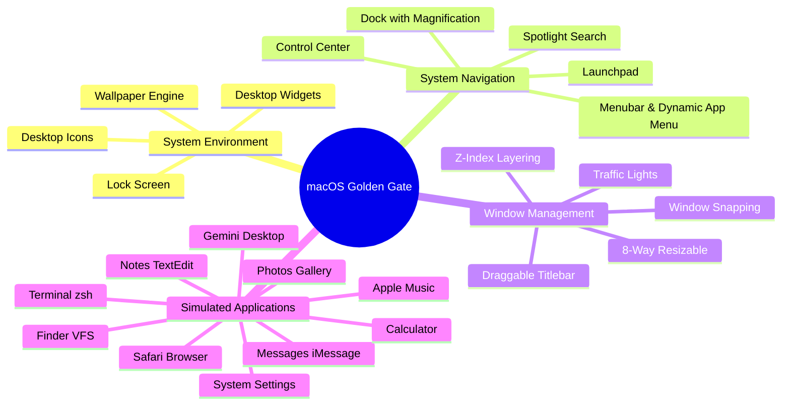
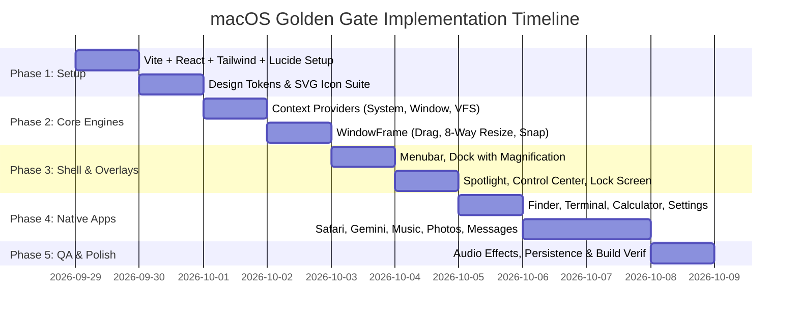

# Product Requirement Document (PRD)
## macOS Golden Gate Desktop Simulator (Web Edition)

| Attribute | Details |
| :--- | :--- |
| **Product Name** | macOS Golden Gate Desktop Simulator |
| **Document Version** | 1.0.0 |
| **Status** | Approved / Ready for Implementation |
| **Target Platform** | Modern Web Browsers (Desktop & Tablet) |
| **Tech Stack** | React 18/19, Vite, Tailwind CSS, Lucide Icons, LocalStorage VFS |
| **Author** | Antigravity AI Engineering Team |

---

## 1. Executive Summary

### 1.1 Product Vision
**macOS Golden Gate Desktop Simulator** adalah sebuah aplikasi web interaktif high-fidelity yang mensimulasikan pengalaman desktop macOS (terinspirasi dari konsep macOS 27 Golden Gate). Produk ini dirancang untuk menghadirkan antarmuka sistem operasi Apple secara detail dan nyata langsung di dalam web browser tanpa instalasi.

### 1.2 Problem Statement
Portfolio web dan simulator antarmuka sering kali terasa statis, kaku, dan sekadar tiruan visual tanpa kedalaman fungsional. Pengguna dan perekrut menginginkan showcase teknis yang mendalam: implementasi window manager riil (drag, 8-way resize, snap tiling, z-index), sistem berkas virtual (VFS), dan aplikasi bawaan yang berfungsi secara interaktif.

### 1.3 Value Proposition
- **Ultra-Realistic UI/UX**: Replikasi pixel-perfect dari Apple Human Interface Guidelines (HIG), glassmorphism, animasi magnification Dock berbasis fisika kursor, dan dynamic menubar.
- **Robust Window Management**: Mesin windowing lengkap yang mendukung multi-instance, layering, minimize/maximize, dragging, dan snapping.
- **10 Interactive Native Apps**: Finder (dengan VFS CRUD), Safari, Gemini Desktop, Music, Photos, Messages, Notes, Terminal, Calculator, dan System Settings.
- **Client-Side Persistence**: Semua aktivitas (file Finder, catatan Notes, riwayat percakapan Gemini, dan konfigurasi tema) tersimpan permanen di `localStorage`.

---

## 2. Product Goals & Success Metrics (KPIs)

### 2.1 Core Goals
1. Menghadirkan simulator macOS berbasis web tercepat dan paling responsif dengan frame-rate stabil pada 60 FPS untuk seluruh animasi interaktif (dock hover, dragging, minimize/restore).
2. Menyediakan ekosistem aplikasi simulasi yang fungsional dan saling terintegrasi (misal: membuka file teks di Finder otomatis meluncurkan TextEdit/Notes).
3. Memastikan arsitektur kode modular berbasis React Context sehingga mudah diperluas dengan aplikasi baru di masa depan.

### 2.2 Success Metrics (KPIs)
- **Performance**:
  - First Contentful Paint (FCP) < 1.0 detik pada jaringan standar.
  - Runtime frame rate: 60 FPS saat memindahkan window atau hover di Dock.
  - Zero hydration/bundle error pada proses `npm run build`.
- **Fidelity & Usability**:
  - 100% responsivitas 8-way window resizing tanpa delay/jitter.
  - 100% persistensi data saat halaman di-refresh (pengaturan tema, wallpaper, file di Finder, chat).
  - Shortcut keyboard native: `Cmd/Ctrl + Space` atau `Cmd/Ctrl + K` untuk Spotlight Search, `Esc` untuk menutup overlay.

---

## 3. User Personas & User Stories

### 3.1 User Personas
1. **Tech Recruiters & Engineering Leads**: Mencari bukti kemampuan frontend tingkat lanjut (state management kompleks, manipulasi DOM performan, mathematical CSS transforms, event handling).
2. **Developers & Designers**: Mengapresiasi fidelity desain, micro-interactions, layout glassmorphism, dan sistem modular.
3. **Casual Users / Enthusiasts**: Menikmati pengalaman eksplorasi antarmuka macOS langsung dari browser Windows, Linux, atau Chromebook.

### 3.2 Key User Stories
- **US-01 (Windowing)**: Sebagai pengguna, saya dapat membuka beberapa aplikasi sekaligus, menggeser (*drag*), mengubah ukuran (*resize* dari 8 penjuru), meminimalkan ke Dock, memaksimalkan ke layar penuh, dan mengklik jendela belakang untuk membawanya ke depan.
- **US-02 (Finder & VFS)**: Sebagai pengguna, saya dapat menjelajahi folder virtual, membuat folder/file baru, mengganti nama (*rename*), menghapus ke Trash, serta membuka file dengan aplikasi yang sesuai.
- **US-03 (Gemini Desktop)**: Sebagai pengguna, saya dapat memilih model AI (Gemini 2.5 Flash, Gemini 2.5 Pro), mengirim pesan simulasi, membaca respon Markdown terformat dengan rapi, dan menyalin blok kode dengan satu klik.
- **US-04 (Terminal)**: Sebagai pengguna, saya dapat mengetik perintah Unix (`ls`, `cd`, `cat`, `clear`, `neofetch`, `date`, `whoami`) dan mendapatkan output bergaya zsh prompt.
- **US-05 (Personalization)**: Sebagai pengguna, saya dapat mengganti wallpaper (Gold, Blue, Purple, Green, Night), mengubah accent color, beralih antara Dark Mode dan Light Mode, serta mengatur ukuran Dock.
- **US-06 (Spotlight)**: Sebagai pengguna, saya dapat menekan tombol pintas untuk membuka Spotlight, mencari aplikasi untuk dibuka langsung, atau mengetik perhitungan matematika instan (`45 * 12`).

---

## 4. Functional Requirements (FR)



### 4.1 System Environment & Overlays

#### FR-01: Menubar (Global & Contextual)
- **Left Section**:
  - **Apple Menu ()**: Modal "About This Mac", shortcut ke "System Settings", "Lock Screen", "Restart" (simulasi reload), "Shut Down" (simulasi black screen dengan tombol boot).
  - **Active App Title**: Menampilkan nama aplikasi yang sedang aktif/fokus (misal: Finder, Safari, Terminal).
  - **Contextual Menus**: File, Edit, View, Go, Window, Help dengan submenu interaktif.
- **Right Status Bar**:
  - Status Wi-Fi & Bluetooth indikator.
  - Battery Level indicator (dengan persentase).
  - Spotlight Search trigger (ikon kaca pembesar).
  - Control Center toggle (ikon switch).
  - Real-time Clock (Hari, Tanggal, Jam, Menit dengan live second update).

#### FR-02: Dock Engine
- **Magnification Effect**: Pembesaran halus pada ikon saat kursor mendekat menggunakan rumus jarak Euclidean / Gaussian curve.
- **App Tooltips**: Label nama aplikasi muncul di atas ikon saat di-hover.
- **Running Indicator**: Titik kecil (*dot*) di bawah ikon menandakan aplikasi sedang terbuka di background.
- **Minimized App Handling**: Klik pada ikon aplikasi yang diminimalkan akan me-restore jendela ke posisi semula dengan transisi smooth.

#### FR-03: System Overlays
- **Spotlight Search (`Cmd/Ctrl + K` atau `Cmd/Ctrl + Space`)**:
  - Modal melayang di tengah layar dengan background acrylic blur.
  - Real-time search: filter aplikasi, dokumen Finder, dan aksi sistem.
  - Calculator Parser: Evaluasi ekspresi matematika langsung saat diketik (contoh: `25 * 14 + 10` langsung memunculkan hasil `= 360`).
  - Keyboard navigation: Panah Atas/Bawah dan `Enter` untuk membuka item.
- **Control Center**:
  - Popover di pojok kanan atas dengan modul glassmorphism:
    - Wi-Fi toggle (On/Off).
    - Bluetooth toggle (On/Off).
    - AirDrop toggle.
    - Dark Mode toggle.
    - Display Brightness slider (mengatur filter overlay brightness desktop).
    - Sound Volume slider (mengatur master volume audio simulator).
    - Now Playing mini widget (sinkron dengan Apple Music app).
- **Launchpad**:
  - Tampilan layar penuh grid aplikasi dengan background ultra-blurred.
  - Live filter search input di bagian atas.
  - Klik aplikasi untuk meluncurkan jendela dan otomatis menutup Launchpad.
- **Lock Screen**:
  - Jam besar bergaya iOS/macOS San Francisco font.
  - Avatar profil pengguna dengan nama akun.
  - Input password dummy atau tombol "Unlock / Enter" untuk membuka desktop.

---

### 4.2 Window Management System (WMS)

| Capability | Specification |
| :--- | :--- |
| **Multi-Window Hosting** | Mendukung pembukaan banyak jendela sekaligus tanpa limit buatan. |
| **Z-Index Layering** | Jendela yang diklik atau diaktifkan otomatis memiliki `zIndex` tertinggi. |
| **Titlebar Dragging** | Dragging presisi menggunakan PointerEvents, dibatasi agar judul jendela tidak hilang di luar viewport. |
| **8-Way Resizing** | Handle tak terlihat di N, S, E, W, NE, NW, SE, SW dengan batas ukuran minimal (*min-width: 320px*, *min-height: 220px*). |
| **Traffic Lights Controls** | - **Merah**: Menutup window.<br>- **Kuning**: Meminimalkan window ke Dock.<br>- **Hijau**: Toggle Maximize / Normal window size. |
| **Traffic Light Hover** | Saat kursor berada di atas area traffic lights, ikon simbol (×, −, +) muncul serentak. |
| **Window Snapping** | Menggeser jendela ke tepi layar memunculkan ghost box preview untuk snap Half-Left, Half-Right, atau Fullscreen. |

---

### 4.3 Native Simulated Applications Suite

#### 1. Finder (Virtual File System)
- **Hierarchy Structure**: Virtual tree memory (`/Users/admin/` berisi Desktop, Documents, Downloads, Pictures, Projects).
- **Navigation**:
  - Sidebar: Favorites (AirDrop, Recents, Applications, Desktop, Documents, Downloads).
  - Breadcrumb path bar & Back/Forward navigation history.
  - View switcher: Icon Grid View vs List Table View.
- **File Operations (CRUD)**:
  - Buat Folder Baru (*New Folder*).
  - Buat Catatan Teks Baru (*New Text File*).
  - Rename file/folder inline.
  - Delete item (pindahkan ke Trash).
  - Double click file dokumen (`.txt`, `.md`) langsung membuka aplikasi Notes / TextEdit.

#### 2. Safari
- Tabbed browsing: Mendukung buka tab baru, tutup tab, dan ganti tab aktif.
- Address bar fungsional: Mendukung input URL atau keyword pencarian.
- Quick Bookmarks Bar: Apple, Gemini, GitHub, YouTube, Google.
- Mock Web Engine: Render halaman mock yang interaktif untuk Google Search, Apple Product Page, dan GitHub Repo.

#### 3. Gemini Desktop (Google Gemini)
- Native macOS dark/light container styling dengan icon Gemini Sparkle dan sidebar riwayat obrolan (*Chat History*).
- Tombol **New Chat** & Model Selector (Gemini 2.5 Flash, Gemini 2.5 Pro, Gemini Ultra).
- Prompt starter cards (Coding, Creative, Data Analysis, Reasoning): Membantu pengguna mencoba interaksi instan.
- Gemini Chat Engine: Respon AI simulasi cerdas dan kontekstual dengan rendering Markdown, format tabel, bullet points, dan blok kode sintaks dengan tombol **Copy Code**.

#### 4. Apple Music
- Interface Apple Music modern: Sidebar (Listen Now, Browse, Radio, Playlists).
- Album Hero Banner dengan gradien dinamis yang selaras dengan album art.
- Interactive Audio Player:
  - Play / Pause toggle.
  - Audio progress track bar (scrubbing/seeking).
  - Next / Previous track controls.
  - Volume slider.
  - Koleksi playlist bawaan (Lo-Fi Beats, Synthwave, Chill Coding).

#### 5. Photos
- Galeri foto resolusi tinggi dengan filter kategori (All Photos, Favorites, Places, Recents).
- Grid Zoom Slider: Mengubah ukuran thumbnail foto secara dinamis (*pinch-zoom effect*).
- Fullscreen Lightbox Modal: Klik foto untuk tampilan penuh dengan navigasi panah kiri/kanan dan tombol close.

#### 6. Messages (iMessage)
- Dual-pane layout: Sidebar daftar kontak (John Appleseed, Sarah Connor, Alex Rivera) dengan avatar dan status unread.
- Chat bubble khas Apple: Bubble biru (*sent*) dan bubble abu-abu (*received*).
- Interactive Message Composer: Input teks dengan emoji picker sederhana dan tombol kirim (Enter / klik panah).
- Auto-reply bot simulasi untuk memberikan pengalaman chatting hidup.

#### 7. Notes
- 3-Column / 2-Column layout: Daftar folder catatan, daftar artikel/notes, dan live editor panel.
- Editor teks langsung: Mengetik judul dan isi catatan secara bebas.
- Auto-save ke `localStorage`: Catatan tidak hilang saat aplikasi ditutup atau browser di-refresh.
- Quick Search bar di dalam Notes untuk memfilter catatan berdasarkan kata kunci.

#### 8. Terminal (macOS zsh)
- Terminal retro-modern dengan window bar gelap dan font monospace Apple (`Menlo`, `Monaco`, `SF Mono`).
- Interaktif CLI Command Parser:
  - `help`: Menampilkan daftar perintah yang tersedia.
  - `ls`: Menampilkan daftar isi direktori aktif.
  - `cd <dir>`: Berpindah direktori virtual.
  - `cat <file>`: Membaca isi file teks virtual.
  - `clear`: Membersihkan layar terminal.
  - `whoami`: Menampilkan username saat ini (`admin@macbook-pro`).
  - `date`: Menampilkan waktu sistem saat ini.
  - `neofetch`: Menampilkan logo Apple ASCII art beserta spesifikasi macOS Golden Gate.
  - `theme <dark|light>`: Mengubah tema sistem lewat baris perintah.

#### 9. Calculator
- Replikasi akurat dari kalkulator native macOS:
  - Display digital responsive dengan font angka besar.
  - Tombol angka dan operator matematika dasar (`+`, `-`, `×`, `÷`, `=`, `%`, `±`, `AC`).
  - Dukungan input dari tombol keyboard fisik pengguna.

#### 10. System Settings
- Tampilan sidebar preferensi (Appearance, Wallpaper, Dock & Menu Bar, Sound & Display, About).
- **Appearance**: Light Mode, Dark Mode, Auto, dan pemilihan Accent Color (Blue, Purple, Pink, Red, Orange, Yellow, Green, Graphite).
- **Wallpaper Picker**: Galeri wallpaper eksklusif (Golden Gate Gold, Deep Blue, Nebula Purple, Forest Green, Midnight Dark).
- **Dock Settings**: Slider ukuran Dock (*Size*) dan toggle pembesaran (*Magnification*).

---

## 5. Non-Functional Requirements (NFR)

### 5.1 Performance & Responsiveness
- **Smooth 60 FPS**: Animasi CSS transform dan hardware acceleration (`will-change: transform`) untuk meminimalkan layout thrashing.
- **Fast Startup**: Inisialisasi awal di bawah 1 detik tanpa file aset berukuran raksasa.
- **Lightweight SVG Icons**: Menggunakan aset vektor SVG murni untuk menjaga ketajaman resolusi Retina Display tanpa membebani bandwidth.

### 5.2 Storage & Persistence
- Menyimpan state persisten menggunakan browser `localStorage`:
  - Kunci `macos_settings`: Theme, wallpaper, accent color, volume, brightness, dock size.
  - Kunci `macos_vfs`: Struktur direktori dan file pengguna.
  - Kunci `macos_notes`: Catatan yang tersimpan di aplikasi Notes.
  - Kunci `macos_gemini_history`: Riwayat percakapan di aplikasi Gemini.
- Graceful Fallback: Jika `localStorage` penuh atau diblokir, sistem tetap berfungsi penuh dalam memory session.

### 5.3 Accessibility & Cross-Browser Compatibility
- Mendukung browser modern: Google Chrome, Mozilla Firefox, Microsoft Edge, Apple Safari, Opera.
- Penanganan pointer events terpadu (`pointerdown`, `pointermove`, `pointerup`) untuk kestabilan drag & resize di layar sentuh (*touchscreen*) maupun mouse.
- Shortcut global:
  - `Cmd / Ctrl + K` atau `Cmd / Ctrl + Space`: Buka / Tutup Spotlight.
  - `Escape`: Tutup modal overlay (Spotlight, Launchpad, Context Menu).

---

## 6. Technical Architecture & State Schema

### 6.1 State Architecture (Context Providers)

```
<SystemProvider>          --> Mengelola Tema, Wallpaper, Accent, Brightness, Volume, Lock State
  <FileSystemProvider>    --> Mengelola Virtual File System (VFS), CRUD Files/Folders
    <WindowProvider>      --> Mengelola Array Windows, Active Window, Min/Max, Z-Index Stack
      <App />             --> Desktop Shell, Menubar, Dock, Overlays, Active Apps
    </WindowProvider>
  </FileSystemProvider>
</SystemProvider>
```

### 6.2 Data Schemas

#### 1. Window Entity
```typescript
interface WindowState {
  id: string;               // Unique ID, e.g. "finder-1", "safari"
  appName: string;          // e.g. "Finder", "Gemini", "Terminal"
  title: string;            // Window titlebar text
  icon: string;             // App icon identifier or SVG
  isOpen: boolean;          // Is window rendered in DOM
  isMinimized: boolean;     // Is window folded into dock
  isMaximized: boolean;     // Is window occupying full viewport
  position: { x: number; y: number };
  size: { width: number; height: number };
  prevRect?: { x: number; y: number; width: number; height: number }; // For restore from maximize
  zIndex: number;
  minSize: { width: number; height: number };
}
```

#### 2. Virtual File System Entity
```typescript
interface FSNode {
  id: string;
  name: string;
  type: 'file' | 'folder';
  parentId: string | null;  // null for root folder
  content?: string;         // For text files / markdown
  fileType?: 'text' | 'image' | 'app' | 'pdf';
  size?: string;
  createdAt: string;
  updatedAt: string;
}
```

#### 3. System Preferences Entity
```typescript
interface SystemPreferences {
  theme: 'dark' | 'light' | 'auto';
  wallpaper: 'gold' | 'blue' | 'purple' | 'green' | 'night';
  accentColor: 'blue' | 'purple' | 'pink' | 'red' | 'orange' | 'yellow' | 'green' | 'graphite';
  dockSize: number;         // Pixel height (default 58px)
  dockMagnification: boolean;
  brightness: number;       // 0.2 to 1.0 (filter brightness)
  volume: number;           // 0 to 100
  isLocked: boolean;        // Lock screen state
}
```

---

## 7. Design System & Apple HIG Tokens (Reference: [DESIGN.md](file:///e:/College%20Stuff/Career/MacOS/DESIGN.md))

Implementasi antarmuka mengacu secara ketat pada spesifikasi desain di [DESIGN.md](file:///e:/College%20Stuff/Career/MacOS/DESIGN.md) yang mengadopsi prinsip *Liquid Glass* dan *Apple Human Interface Guidelines (HIG)*:

### 7.1 Visual Tokens & Color Architecture
- **Primary Accent**: `#007AFF` (Blue), `#AF52DE` (Purple), `#FF2D55` (Pink), `#FF3B30` (Red), `#FF9500` (Orange), `#FFCC00` (Yellow), `#34C759` (Green), `#8E8E93` (Graphite).
- **Glassmorphic Surfaces**:
  - Light Glass: `rgba(255, 255, 255, 0.65)` dengan border `1px solid rgba(255, 255, 255, 0.40)`.
  - Dark Glass: `rgba(30, 30, 30, 0.70)` dengan border `1px solid rgba(255, 255, 255, 0.12)`.
  - Acrylic Overlay: `rgba(20, 24, 33, 0.85)`.
  - Blur Levels: Menubar/Sidebar `backdrop-blur-xl` (20px), Dock/Spotlight/Launchpad `backdrop-blur-2xl` (40px).
- **Text & Contrast (No Pure Black)**:
  - Primary text: Soft dark `#0F172A` (Light mode) / `#F8FAFC` (Dark mode).
  - Secondary text: `#64748B` (Light mode) / `#94A3B8` (Dark mode).
- **Traffic Light Controls**:
  - Close (Red): `#FF5F56` (Border: `#E0443E`)
  - Minimize (Yellow): `#FFBD2E` (Border: `#DEA123`)
  - Maximize (Green): `#27C93F` (Border: `#1AAB29`)
  - Hover: Glyph micro symbols (`×`, `−`, `+`) muncul serentak saat kursor hover.

### 7.2 Spacing, Radii & Nested Radius Formula
- **Grid Skala**: Kelipatan token 4px / 8px (4, 8, 12, 16, 24, 32).
- **Formula Nested Radius**: `r_inner = max(0, r_outer - padding)`.
- **Corner Radii**: `sm` (4px), `md` (8px), `lg` (12px), `window` (16px), `widget` (20px), `full` (9999px).

### 7.3 Elevation & Layering Levels
- **Level 0**: Base Wallpaper Canvas (Fluid ribbons: Gold, Blue, Purple, Green, Night).
- **Level 1**: Desktop Icons & Quick Widgets (`rounded-[20px]`).
- **Level 2**: Inactive Background Windows (`box-shadow: 0 12px 24px -6px rgba(0, 0, 0, 0.15)`).
- **Level 3**: Active Focused Window (`box-shadow: 0 24px 48px -12px rgba(15, 34, 58, 0.25)`).
- **Level 4**: Fixed System Shell (Menubar `h-[28px]`, Floating Dock `h-[58px]`).
- **Level 5**: Floating Modals (Spotlight 600px width, Control Center 320px popover, Context Menus).
- **Level 6**: Fullscreen Lock Screen Guard.

---

## 8. Implementation Roadmap & Phases



### Milestones
1. **M1 (Core Windowing)**: Window dapat di-spawn, di-drag, di-resize dari 8 arah, dan diatur z-index layer-nya.
2. **M2 (Desktop Shell & Menus)**: Menubar aktif, Dock magnification berfungsi, Spotlight dan Control Center dapat dibuka.
3. **M3 (Core Productivity Apps)**: Finder VFS CRUD selesai, Terminal CLI interaktif, Calculator fungsional, dan Settings sinkron dengan tema.
4. **M4 (Rich Media & Comms Suite)**: Safari browser mockup, Gemini AI bot interaktif, Apple Music player, Photos gallery, dan Messages live chatting.
5. **M5 (Final Polish & Release)**: LocalStorage synchronization, SFX audio click opsional, keyboard shortcuts, dan verifikasi build zero-error.

---

## 9. Risk Assessment & Mitigations

| Risk | Impact | Likelihood | Mitigation Strategy |
| :--- | :---: | :---: | :--- |
| **Window Drag/Resize Lag** | High | Low | Gunakan `PointerEvents` dengan `requestAnimationFrame` atau direct CSS transform coordinates tanpa re-render state berlebihan. |
| **Z-Index Collision** | Medium | Low | Gunakan state counter z-index global tunggal di `WindowContext` yang selalu bertambah saat suatu window difokuskan. |
| **LocalStorage Exceeded** | Low | Low | Simpan hanya data metadata teks dan base64 thumbnail berukuran kecil; file dummy VFS diatur dalam batas wajar (< 2MB). |
| **Viewport Overflow pada Layar Kecil** | Medium | Medium | Pasang clamping logic pada posisi window agar titlebar tidak pernah keluar dari batas pandang layar. |

---

## 10. Acceptance Criteria (Definition of Done)
1. Seluruh 10 aplikasi bawaan dapat dibuka dari Dock, Launchpad, maupun Spotlight Search.
2. Window management berjalan mulus: dragging tidak lepas saat mouse digerakkan cepat, 8 handle resize berfungsi akurat di setiap sudut dan sisi.
3. Magnification Dock membesar secara halus berdasarkan posisi mouse horizontal.
4. Spotlight Search dapat melakukan perhitungan matematika instan dan meluncurkan aplikasi via keyboard (`Enter`).
5. Perubahan tema, wallpaper, file Finder, dan catatan tersimpan di `localStorage` dan bertahan saat halaman di-refresh.
6. Kode bebas error kompilasi dan lulus `npm run build`.
