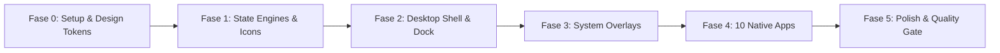

# macOS Golden Gate Desktop Simulator - Execution Roadmap

Dokumen ini merupakan panduan langkah demi langkah (*step-by-step engineering roadmap*) untuk membangun simulator **macOS Golden Gate** berbasis **React + Vite + Tailwind CSS**, mengintegrasikan spesifikasi [DESIGN.md](file:///e:/College%20Stuff/Career/MacOS/DESIGN.md), [PRD.md](file:///e:/College%20Stuff/Career/MacOS/PRD.md), serta standar kualitas dari installed skills (`antislop`, `logo-grid-system`, `ponytail`).

---

## 🛠️ Pemanfaatan Skills yang Terpasang

| Skill Terpasang | Peran dalam Proyek | Nilai Tambah |
| :--- | :--- | :--- |
| **`antislop`** | **Quality & Anti-Slop Filter** | Menjamin tidak ada elemen mati (*no dead buttons/links*), kontras teks WCAG AA (>4.5:1), tidak ada teks hitam pekat `#000000`, navigasi keyboard lengkap (`Tab`, `Esc`, shortcut), responsif tanpa overflow, dan Delivery Gate verification. |
| **`logo-grid-system`** | **Icon & Vector Mark Engineering** | Merancang ikon native SVG macOS (Finder, Safari, Gemini Sparkle, Music, Photos, Terminal, dll.) menggunakan base unit $x$, nested radius konsentris, dan optical correction agar tajam di berbagai resolusi layar. |
| **`ponytail`** | **Clean Architecture & Anti-Overengineering (YAGNI)** | Memprioritaskan native web APIs (CSS transforms, PointerEvents, HTML5 Audio, Web Storage) daripada library pihak ketiga yang membengkakkan bundle. Kode ringkas, modular, dan terisolasi tanpa abstraction layer yang tidak perlu. |
| **`generative_ui`** | **Rich Presentation & Interactive Visuals** | Render visualisasi status, preview komponen, dan visual reports. |

---

## 🗺️ Engineering Roadmap (Fase 0 s/d Fase 5)

---

### 🟢 Fase 0: Project Setup & Design Token Integration
- [x] **0.1**: Inisialisasi Vite + React project di direktori `e:\College Stuff\Career\MacOS`.
- [x] **0.2**: Pasang dependensi utama: `tailwindcss`, `postcss`, `autoprefixer`, `lucide-react`, `canvas-confetti`.
- [x] **0.3**: Konfigurasi `tailwind.config.js` berbasis token [DESIGN.md](file:///e:/College%20Stuff/Career/MacOS/DESIGN.md):
  - Palet warna: `primary`, `surface-glass` (`rgba(255,255,255,0.65)`), `surface-glass-dark`, `border-glass`, 8 Apple accent colors, traffic light hex codes.
  - Border radius: `window: 16px`, `widget: 20px`, `full: 9999px`.
  - Backdrop blur: `xl: 20px`, `2xl: 40px`.
  - Apple elevation shadow tokens (Level 2 s/d Level 5).
- [x] **0.4**: Setup `index.css`:
  - Reset layout & font Apple system (`-apple-system, BlinkMacSystemFont, "SF Pro Text"`).
  - Glassmorphism utility classes & custom slim scrollbars.

---

### 🟢 Fase 1: State Engines, Hooks & Icon Suite
- [x] **1.1**: **`SystemContext.jsx`**:
  - State: `theme` (light/dark/auto), `wallpaper` (gold, blue, purple, green, night), `accentColor`, `brightness`, `volume`, `isLocked`.
  - Integrasi auto-sync ke `localStorage`.
- [x] **1.2**: **`FileSystemContext.jsx`**:
  - Virtual File System (VFS) in-memory tree (`/Users/admin/Desktop`, `Documents`, `Downloads`, `Pictures`, `Projects`).
  - Actions: `createFile`, `createFolder`, `renameNode`, `deleteNode`, `readFile`.
- [x] **1.3**: **`WindowContext.jsx`**:
  - State: daftar window terbuka, `activeWindowId`, z-index counter global.
  - Actions: `openWindow(appId)`, `closeWindow(id)`, `minimizeWindow(id)`, `maximizeWindow(id)`, `focusWindow(id)`, `updatePosition`, `updateSize`, `snapWindow`.
- [x] **1.4**: **Custom Hooks**:
  - `useDraggable.js`: Pointer events dragging dengan batas pandang (*clamping boundaries*).
  - `useResizable.js`: 8-way resize math (N, S, E, W, NE, NW, SE, SW) dengan batas minimal 320×220px.
  - `useDockMagnification.js`: Gaussian-curve magnification berbasis jarak Euclidean kursor.
  - `useShortcuts.js`: Global listener `Cmd/Ctrl + K` / `Space` dan `Escape`.
- [x] **1.5**: **SVG Icon Library (`src/components/common/icons/`)**:
  - Dibuat mengikuti standar `logo-grid-system`: Finder, Safari, Gemini Sparkle, Music, Photos, Messages, Notes, Terminal, Calculator, Settings.

---

### 🟢 Fase 2: Desktop Shell & System Navigation
- [x] **2.1**: **Base Canvas & Wallpaper Engine**:
  - Render latar belakang fluid ribbons (Gold, Blue, Purple, Green, Midnight) dengan filter brightness dari `SystemContext`.
- [x] **2.2**: **Desktop Widgets & Desktop Icons**:
  - Cupertino Weather widget & Calendar widget dengan nested radius konsentris (`rounded-widget`).
  - Desktop shortcut icons (Macintosh HD, Documents, Readme) yang sinkron dengan VFS.
- [x] **2.3**: **Top Menubar (`h-28px`)**:
  - Apple Menu () popover: About This Mac, System Settings, Lock Screen, Restart, Shut Down.
  - Contextual App Menu: Dinamis sesuai aplikasi yang sedang fokus (File, Edit, View, Window, Help).
  - Status bar kanan: Wi-Fi status, Battery indicator, Spotlight trigger, Control Center toggle, Real-time Clock dengan detik.
- [x] **2.4**: **Floating Dock (`h-58px`)**:
  - Magnification animation 60 FPS hingga skala 1.35×.
  - Running indicator dot di bawah aplikasi aktif.
  - Tooltip nama aplikasi saat hover.
  - Klik untuk meluncurkan atau restore aplikasi yang diminimalkan.
- [x] **2.5**: **Window Host & WindowFrame**:
  - Komponen wrapper jendela dengan titlebar draggable, 8-way invisible handles, traffic lights (`×`, `−`, `+` on hover), dan ghost-box snapping preview.

---

### 🟢 Fase 3: System Overlays
- [x] **3.1**: **Spotlight Search Modal (`Cmd/Ctrl+K` / `Cmd/Ctrl+Space`)**:
  - Lebar 600px, acrylic frosted glass, floating di tengah layar.
  - Real-time instant search: aplikasi, file VFS, dan kalkulator matematika instan (`25 * 4 = 100`).
  - Navigasi keyboard penuh (`ArrowUp`, `ArrowDown`, `Enter`, `Escape`).
- [x] **3.2**: **Control Center Popover**:
  - Lebar 320px di pojok kanan atas.
  - Modul Wi-Fi, Bluetooth, Dark Mode toggle.
  - Master Sliders: Display Brightness & System Audio Volume.
  - Now Playing mini controller (terhubung ke Apple Music).
- [x] **3.3**: **Launchpad**:
  - Tampilan grid fullscreen ultra-blurred (`backdrop-blur-2xl`).
  - Live search input & interaksi klik untuk meluncurkan aplikasi.
- [x] **3.4**: **Lock Screen Guard**:
  - Jam besar San Francisco Display, tanggal, avatar profil pengguna, dan tombol unlock.
- [x] **3.5**: **About This Mac Modal**:
  - Spesifikasi sistem macOS Golden Gate (Chip, Memory, OS version, Serial Number dummy).

---

### 🟢 Fase 4: Simulated Core Applications Suite (10 Aplikasi)
- [x] **4.1**: **Finder**:
  - Dual-pane: Sidebar Favorites & Main file explorer.
  - View switcher: Icon Grid View vs List Table View.
  - Toolbar aksi: Buat folder baru, buat text file, rename, hapus ke Trash.
  - Double-click file teks langsung meluncurkan aplikasi Notes.
- [x] **4.2**: **Terminal (macOS zsh)**:
  - Retro-modern dark console (`rgba(15,23,42,0.90)`).
  - Interactive commands: `help`, `ls`, `cd`, `cat`, `clear`, `whoami`, `date`, `neofetch` (Apple ASCII art), `theme`.
- [x] **4.3**: **Calculator**:
  - Tata letak kalkulator native macOS dengan display responsif, operasi aritmatika lengkap, dan input keyboard fisik.
- [x] **4.4**: **Notes (TextEdit)**:
  - Multi-note manager: daftar catatan di sidebar, live text/markdown editor, fitur pencarian catatan, dan auto-save ke `localStorage`.
- [x] **4.5**: **Gemini Desktop (Google Gemini)**:
  - UI modern dengan logo Gemini Sparkle.
  - Model selector: Gemini 2.5 Flash, Gemini 2.5 Pro, Gemini Ultra.
  - Starter prompt cards (*Coding*, *Creative Writing*, *Data Analysis*, *Reasoning*).
  - Chat engine simulasi dengan rendering Markdown & tombol **Copy Code**.
  - Riwayat percakapan tersimpan di `localStorage`.
- [x] **4.6**: **Safari Browser**:
  - Tabbed navigation (tambah tab, tutup tab, pindah tab).
  - Address bar untuk URL / pencarian.
  - Quick bookmarks bar (Apple, Gemini, GitHub, YouTube, Google).
  - Mock web render: Halaman hasil Google Search, Apple info, dan GitHub project.
- [x] **4.7**: **Apple Music**:
  - Hero album banner dengan gradien dinamis.
  - Track list dan kontrol audio interaktif: Play/Pause, seek track bar progress, Next/Prev track, Volume control.
  - Termasuk audio player fungsional dengan sample ambient/lo-fi tracks.
- [x] **4.8**: **Photos**:
  - Grid galeri foto resolusi tinggi.
  - Zoom slider untuk mengubah skala grid foto secara dinamis.
  - Lightbox modal ukuran penuh dengan navigasi panah kiri/kanan.
- [x] **4.9**: **Messages (iMessage)**:
  - Sidebar daftar obrolan kontak.
  - Chat bubble biru (user) dan abu-abu (kontak).
  - Interactive composer untuk mengirim pesan dan bot auto-reply responsif.
- [x] **4.10**: **System Settings**:
  - Sidebar preferensi: Appearance (Light/Dark/Auto, Accent Color picker), Wallpaper gallery selector, Dock size & magnification slider.

---

### 🟢 Fase 5: Antislop Quality Gate & Verification
- [ ] **5.1**: **Anti-Slop Craftsmanship Audit**:
  - Verifikasi R-26: Seluruh tombol dan kontrol memiliki fungsi nyata (*zero dead buttons*).
  - Verifikasi R-25: Seluruh teks memenuhi rasio kontras WCAG AA (>4.5:1), tidak ada `#000000` murni.
  - Verifikasi R-32: Aksesibilitas keyboard teruji (`Tab`, `Esc` untuk menutup modal, shortcut Spotlight).
  - Verifikasi R-03: Tata letak responsif dan tidak ada overflow horizontal pada resolusi tablet/laptop.
- [ ] **5.2**: **Build & Bundle Verification**:
  - Eksekusi `npm run build` untuk memastikan zero TypeScript/JSX errors dan bundle size optimal.
- [ ] **5.3**: **Manual Click-Through Evidence**:
  - Uji kelancaran 60 FPS pada dragging dan docking, verifikasi persistensi `localStorage`.
